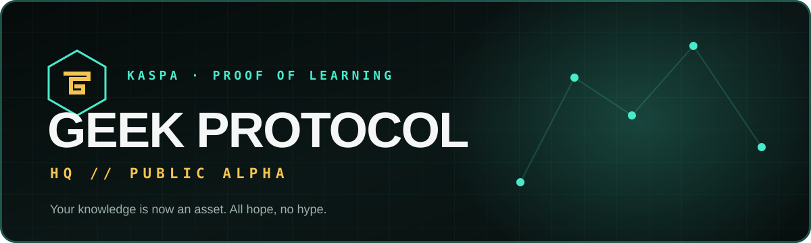
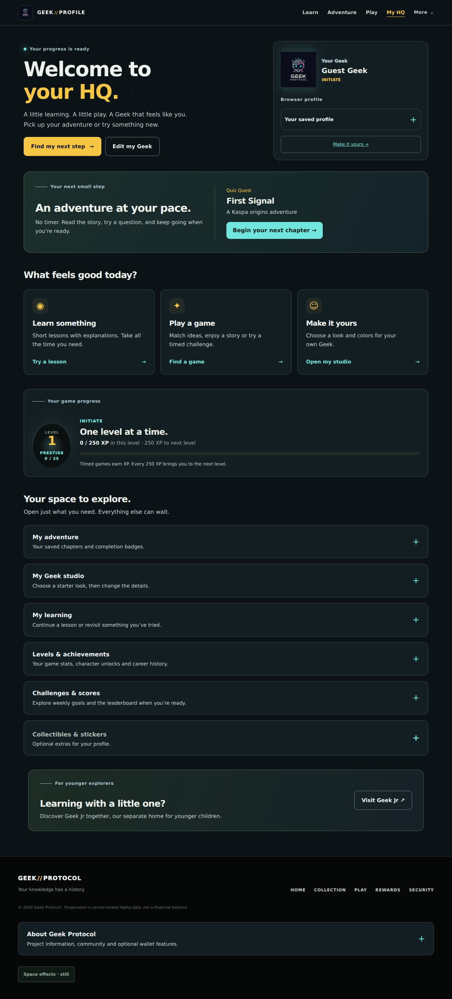
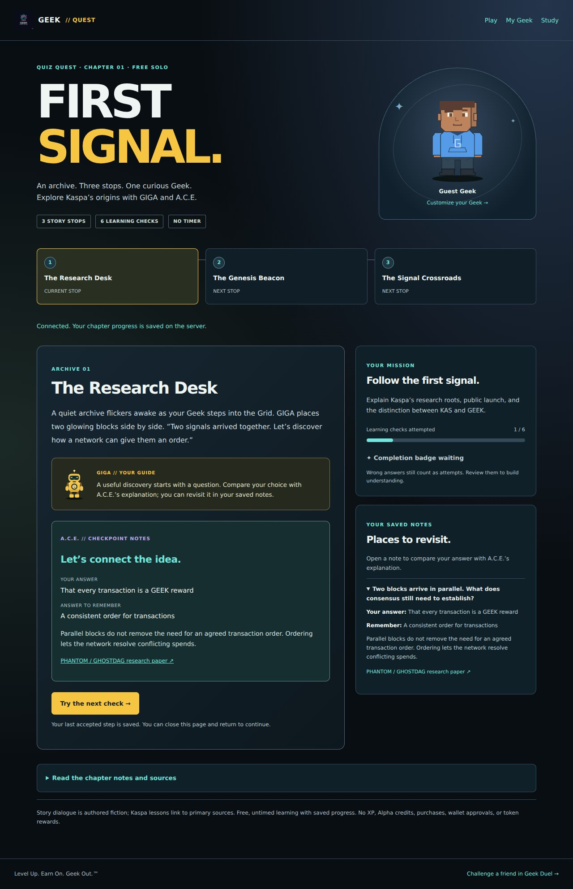

<div align="center">
  

  **Learn Kaspa by playing. Earn XP by proving it. All Hope. No Hype.**

  ### [▶ Play now at geekprotocol.xyz](https://www.geekprotocol.xyz/)

  [Play](https://www.geekprotocol.xyz/play/) · [Study](https://www.geekprotocol.xyz/study/) · [Lobby](https://www.geekprotocol.xyz/lobby/) · [Mint](https://www.geekprotocol.xyz/mint/) · [Security](https://www.geekprotocol.xyz/security/) · [Docs](docs/README.md)
</div>

---

> **Screenshots:** these images are already in the repo. Replace or add to them as the UI changes:
> `docs/assets/hq-calm-overview.jpg`, `docs/assets/hq-calm-mobile.jpg`, `docs/assets/quiz-quest-preview.jpg`, `docs/assets/geek-duel-preview.png`, `docs/assets/ace-solo-duel.jpg`, `docs/assets/personal-geeks-preview.png`

<p align="center">
  
  
</p>

## What is Geek Protocol?

Geek Protocol HQ is a security-first **Proof-of-Learning** and trivia platform for the Kaspa ecosystem. New players learn how Kaspa works through short lessons, practice, and timed quizzes. Your answers are scored on the server. Answer keys stay private, the browser never decides your score, and anything that moves value stays locked until it has been reviewed separately.

The project is in **public Alpha**. See [Project status](docs/PROJECT-STATUS.md) and [Start Here](START-HERE.md).

## Features

All of these are in this repository today (`public/` and `api/`):

- **Learn and Study** (`/kaspa/`, `/study/`): Kaspa lessons, guided study, and the Ace tutor ([Study protocol](docs/STUDY-PROTOCOL.md)).
- **Practice** (`/practice/`): untimed practice rounds before ranked play.
- **Ranked Gauntlet** (`/play/`): a solo game with timed questions and server scoring.
- **Quiz Quest** (`/quest/`): a campaign with chapters ([Quest protocol](docs/QUEST-PROTOCOL.md)).
- **Duels** (`/duel/`): head-to-head play ([Duel protocol](docs/DUEL-PROTOCOL.md)).
- **Lobbies** (`/lobby/`): shared rooms with ten timed questions and server-scored standings.
- **Trivia Royale** (`/royale/`): elimination rooms for 2–100 players. Gives no XP and no rewards ([Royale protocol](docs/ROYALE-PROTOCOL.md)).
- **Challenges and Memory Grid** (`/challenges/`, `/memory/`).
- **Profile and Personal Geek builder** (`/profile/`): level, prestige, and a customizable avatar.
- **The Grid collection and daily Vault** (`/collection/`, `/vault/`): cosmetic collection and one visible seal per UTC day.
- **Mint page** (`/mint/`): mint guidance for $GEEK through Kasware ([Mint protocol](docs/MINT-PROTOCOL.md)).
- **Rewards and economy info** (`/rewards/`, `/economy/`, `/litepaper/`): testnet reward status and how the economy works.
- **Community contributions** (`/contribute/`, `/thanks/`): submit questions and see the Hall of Thanks.
- **Passkey sign-in** (`/sign-in/`), guest-first.

Topics in the question banks (`server/questions/`): Kaspa, history, comics, movies, pop culture, science fiction, and more.

## The $GEEK token

- **$GEEK is a KRC-20 token on Kaspa.**
- **Max supply: 144B. No premint.**
- **Fair mint:** 100k per mint through **Kasware**. See the [mint page](https://www.geekprotocol.xyz/mint/).
- **The Gauntlet never pays out tokens.** It pays only **XP** and **off-chain Alpha credits**.
- **Testnet rewards use GEEKT**, a testnet asset with no mainnet value ([Testnet reward pilot](docs/TESTNET-REWARD-PILOT.md)).

> **Not financial advice.** Geek Protocol is a learning game. Nothing here is investment advice, and we don't discuss price. Do your own research and never share your seed phrase. Geek Protocol will never ask for it.

## Local setup (3 steps)

Requires **Node.js 22+** (per `package.json` `engines`) and npm.

```sh
# 1. Clone and install the locked dependencies
git clone https://github.com/GEEKProtocol0110/geek-protocol-hq.git && cd geek-protocol-hq
npm ci --ignore-scripts

# 2. Create local config (safe placeholders; never use production secrets)
cp .env.example .env.local

# 3. Run the full verification suite
npm run verify        # or just: npm test
```

Vercel serves `public/` and discovers serverless functions in `api/`. Static pages work without Redis. Stateful and ranked features need Upstash Redis credentials and are built to fail closed when storage is missing. Other useful scripts: `npm run questions:check`, `npm run security:check`, `npm run site:check`.

## Project structure

```
api/        Vercel serverless endpoints
server/     Server-only logic: scoring, question banks (server/questions/), audits, ops UI
public/     Static site, one folder per page (play/, study/, duel/, quest/, lobby/, mint/, profile/ …)
workers/    Isolated testnet signer worker (workers/testnet)
scripts/    Checks and generators (question banks, security, site pages, continuity)
tests/      node --test suites
security/   Security controls register (controls.json)
docs/       Protocol docs, roadmap, continuity record, assets
```

## Contributing

Contributions are welcome. Read [CONTRIBUTING.md](CONTRIBUTING.md), [AGENTS.md](AGENTS.md), and the [Code of Conduct](CODE_OF_CONDUCT.md). Look for issues labeled **good first issue** to get started.

## Security

Please don't open a public issue for a vulnerability. Follow [SECURITY.md](SECURITY.md). Also see the [threat model](docs/THREAT-MODEL.md) and the [security page](https://www.geekprotocol.xyz/security/).

## Roadmap

These items come from [ROADMAP-CHECKPOINT](docs/ROADMAP-CHECKPOINT.md), [PRODUCT-ROADMAP](docs/PRODUCT-ROADMAP.md), and [BACKLOG](docs/continuity/BACKLOG.md):

- Audit every question category, then grow Kaspa toward 1,000 reviewed concepts (BANK-009, BANK-001).
- Polish the Learn → Study → practice path for new players.
- Finish the acceptance checks for real devices, community testing, and funded wallets ([NEXT-FIVE-ACCEPTANCE](docs/NEXT-FIVE-ACCEPTANCE.md)).
- Run a production pilot of Trivia Royale.
- Build out the creator ecosystem and contributor governance (PRODUCT-ROADMAP §3, §5).
- *Suggested, not in the docs yet:* translations and a public CI test badge for each page.

## License

[MIT](LICENSE)

## Community

- X: [x.com/geekonkas](https://x.com/geekonkas)
- Telegram: [t.me/GEEKonKAScommunity](https://t.me/GEEKonKAScommunity)

*All Hope. No Hype.*
